# Desafio das Emoções + IA — UFP

Jogo educativo da **UFP (Universidade Fernando Pessoa)** que usa Inteligência Artificial e Visão Computacional, diretamente no browser, para reconhecer **emoções faciais** e **gestos com as mãos**. As rondas de câmara alternam com perguntas sobre IA e programação, e o jogo acaba com uma reflexão sobre o que a IA *não* consegue fazer.

Funciona de duas formas:

- **Aplicação de secretária** (macOS e Windows), com atualizações automáticas;
- **Versão web**, servida por um pequeno servidor Express.

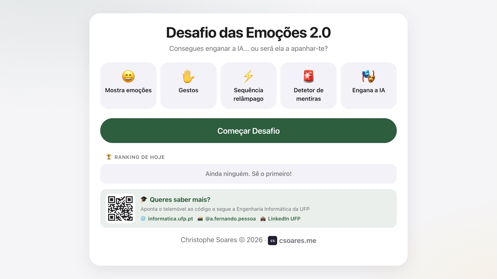

## 🎮 O jogo

Cada jogo tem **10 rondas** (100 pontos cada, 1000 no máximo), de cinco tipos:

| Ronda | O que é preciso fazer |
|---|---|
| 😄 **Mostra a emoção** | Fazer a cara pedida e aguentá-la 1 segundo. Quanto mais depressa, mais pontos. |
| ✋ **Gestos** | Mostrar gestos com as mãos (👍, ✊, ✌️, 🫶 com as duas mãos…). |
| ⚡ **Sequência relâmpago** | Fazer 5 emoções seguidas o mais depressa possível. |
| 🎭 **Engana a IA** | Mostrar uma emoção com uma regra difícil (ex.: tapar metade da cara). |
| 🚨 **Detetor de mentiras** | A IA "acusa" o jogador de coisas e ele tem de manter a cara de póquer. |
| 🧠 **Perguntas** | Perguntas sobre IA e visão computacional; a última é sempre de código. |

O último detetor de mentiras termina com uma **revelação**: a IA não deteta mentiras de verdade, e o AI Act europeu proíbe este tipo de uso em muitos contextos.

No fim aparece a pontuação, o resultado de cada ronda e um **ranking do dia** opcional (só ficam guardadas as iniciais e os pontos, nesta máquina).

### Capturas de ecrã

<table>
  <tr>
    <td><br><sub>Apresentação de cada ronda, com 3-2-1</sub></td>
    <td>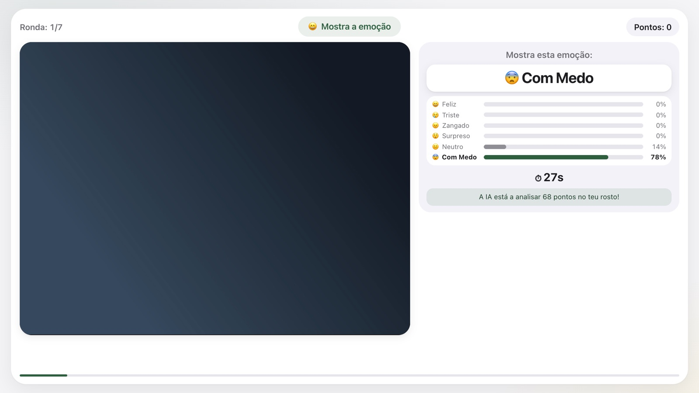<br><sub>Mostra a emoção, com as barras de deteção em direto</sub></td>
  </tr>
  <tr>
    <td>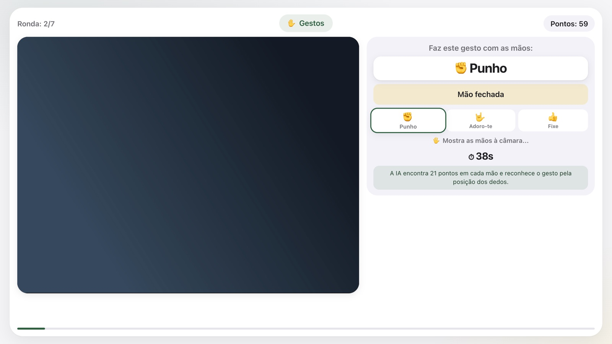<br><sub>Gestos com as mãos (MediaPipe)</sub></td>
    <td>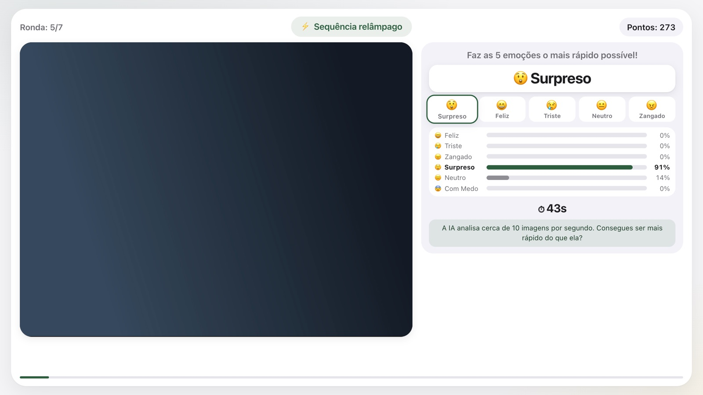<br><sub>Sequência relâmpago</sub></td>
  </tr>
  <tr>
    <td>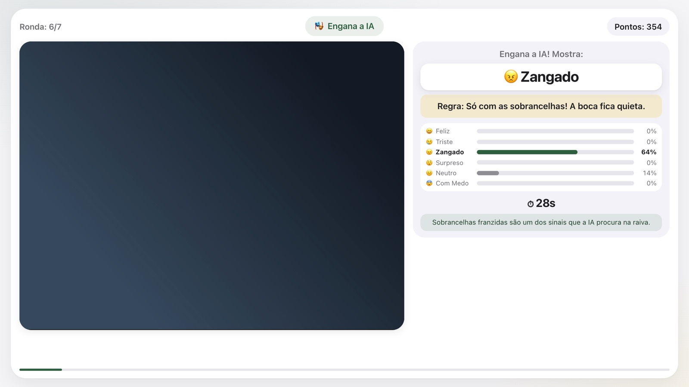<br><sub>Engana a IA</sub></td>
    <td>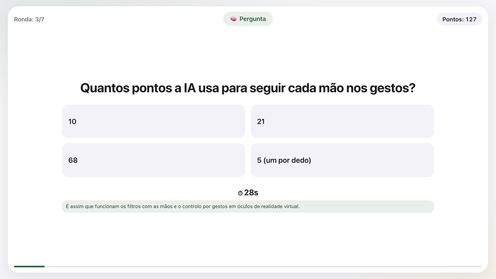<br><sub>Pergunta sobre IA</sub></td>
  </tr>
  <tr>
    <td>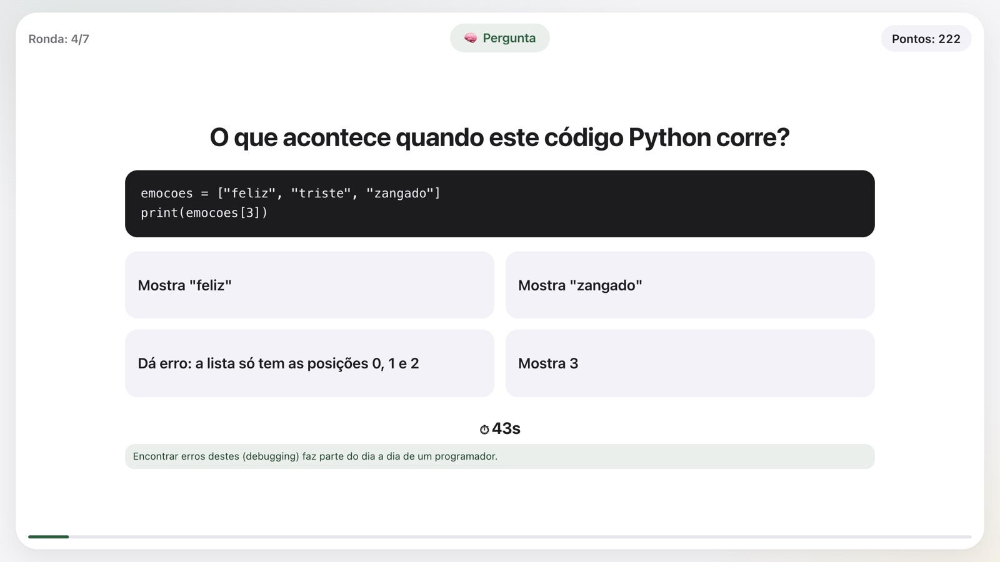<br><sub>Pergunta de código</sub></td>
    <td>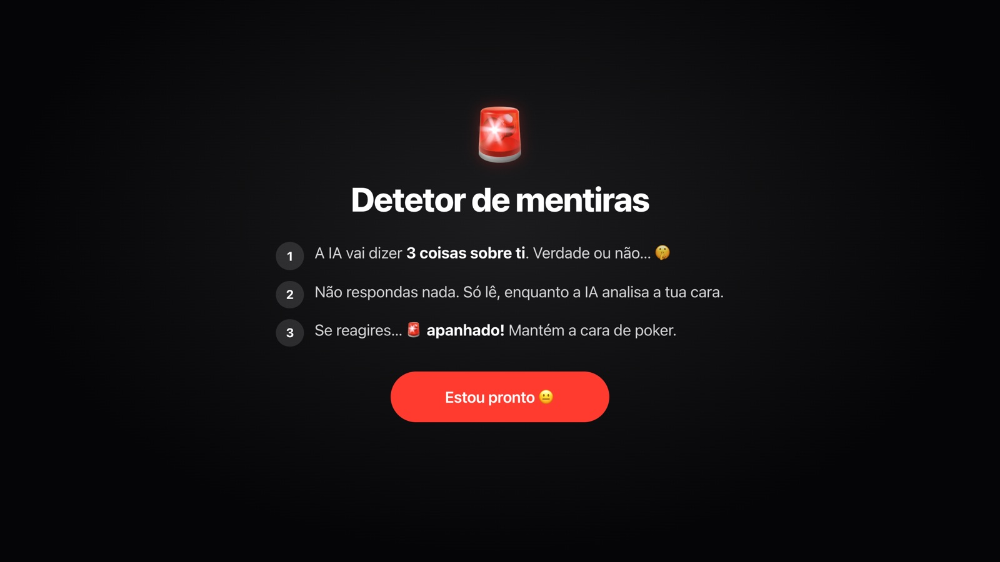<br><sub>Detetor de mentiras: regras</sub></td>
  </tr>
  <tr>
    <td>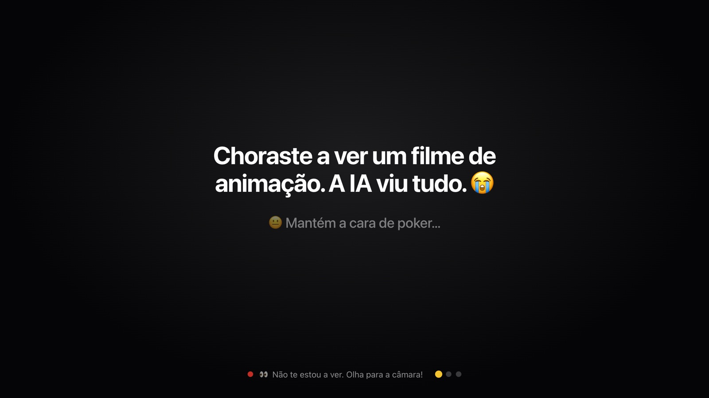<br><sub>Detetor de mentiras: a IA "acusa"</sub></td>
    <td>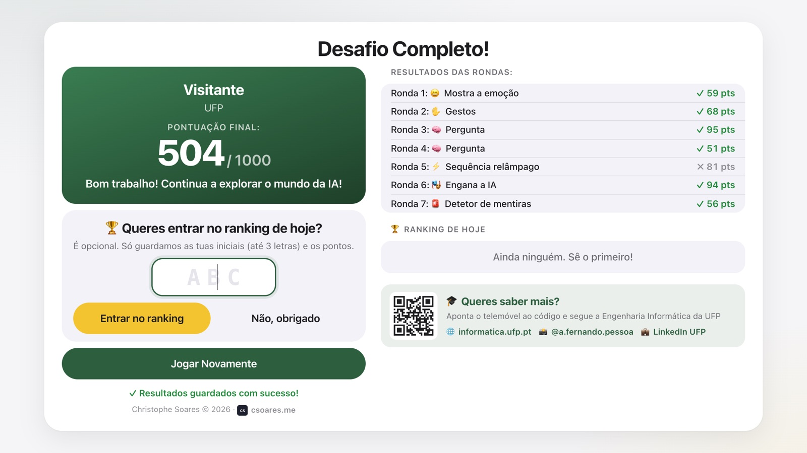<br><sub>Resultados e ranking do dia</sub></td>
  </tr>
</table>

<sub>Nas capturas, a imagem da câmara foi substituída por um fundo neutro.</sub>

## 💻 Aplicação de secretária (recomendado)

Descarrega a versão mais recente em **[Releases](https://github.com/csoares/ArtificialIntelligenceGame/releases/latest)**:

| Sistema | Ficheiro |
|---|---|
| macOS (Apple Silicon: M1, M2, M3…) | `Emotions-Challenge-<versão>-mac-arm64.dmg` |
| macOS (Intel) | `Emotions-Challenge-<versão>-mac-x64.dmg` |
| Windows 10 ou 11 | `Emotions-Challenge-Setup-<versão>.exe` |

**Requisitos:** Windows 10 ou mais recente, ou macOS 11 (Big Sur) ou mais recente, e uma câmara. O **Windows 7, 8 e 8.1 não são suportados** (o Electron deixou de os suportar). Nesses computadores, usa a versão web num browser atual.

**macOS:** a aplicação não é assinada com um certificado da Apple. Na primeira vez, abre-a com **clique direito → Abrir** (ou em *Definições do Sistema → Privacidade e Segurança → Abrir mesmo assim*). Arrasta-a para a pasta **Aplicações** antes de a usar, para as atualizações automáticas funcionarem.

**Atualizações automáticas:** a aplicação procura novas versões ao arrancar e de 4 em 4 horas. Pergunta sempre antes de descarregar e antes de reiniciar, e nunca interrompe um jogo a decorrer. Durante o download aparece uma barra de progresso.

**Exportar resultados:** menu **Arquivo → Exportar Resultados** (Ctrl/Cmd+E) ou o botão no ecrã final.

## 🌐 Versão web

Requer [Node.js](https://nodejs.org/).

```bash
npm install
npm start          # http://localhost:3000
```

Abre `http://localhost:3000` no browser e autoriza o acesso à câmara.

Os resultados são guardados em **`resultados_emocoes.csv`**, na pasta do projeto (colunas `FirstName, LastName, School, Score, Timestamp`; a pontuação é convertida para a escala antiga de 0 a 5). O botão **"Exportar Dados CSV"** descarrega o ficheiro.

## 🖥️ Modo Kiosk (eventos e feiras)

| | Modo normal | Modo kiosk |
|---|---|---|
| Registo | Pede nome, apelido e escola | Salta o registo (jogador = "Visitante") |
| "Jogar Novamente" | Volta ao registo | Volta diretamente ao jogo |
| Câmara | Liga em cada jogo | Fica sempre ligada |

<table>
  <tr>
    <td>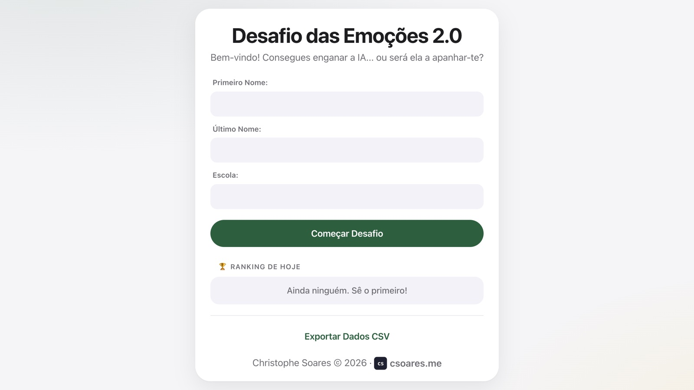<br><sub>Modo normal: registo</sub></td>
    <td><br><sub>Modo kiosk: ecrã inicial</sub></td>
  </tr>
</table>

Para mudar, edita `kioskMode` em **`config.js`** e recarrega a página (na aplicação de secretária, a alteração só entra numa nova build):

```javascript
const APP_CONFIG = {
    kioskMode: true   // false = modo normal
};
```

## 🛠 Desenvolvimento

```bash
npm install
npm run dev            # servidor web com auto-reload (nodemon)
npm run electron       # aplicação de secretária
npm run electron-dev   # aplicação a carregar http://localhost:3000, com DevTools (requer npm start)
npm run build          # build para o sistema atual → dist-electron/
```

Não há bundler: o frontend é JavaScript simples carregado com `<script>`.

### Estrutura

```
├── index.html              # Ecrãs do jogo
├── app.js                  # Lógica do jogo (rondas, deteção, pontuação, ranking)
├── config.js               # Configuração (modo kiosk)
├── style.css               # Estilos (pensado para 1280×720)
├── server.js               # Servidor Express da versão web (CSV)
├── electron/
│   ├── main.js             # Processo principal, menu e atualizações automáticas
│   ├── preload.js          # Ponte segura renderer ↔ main
│   └── mac-updater.js      # Atualizador próprio do macOS (app não assinada)
├── models/                 # Modelos face-api.js e MediaPipe (gestos)
├── lib/                    # face-api.js e outras bibliotecas
├── assets/                 # Favicon e QR code do curso
├── build/                  # Ícones e scripts de build (electron-builder)
└── docs/screenshots/       # Capturas de ecrã deste README
```

### Tecnologias

- **[face-api.js](https://github.com/justadudewhohacks/face-api.js)** (TensorFlow.js): deteção de cara, 68 pontos faciais e 7 expressões;
- **[MediaPipe Gesture Recognizer](https://ai.google.dev/edge/mediapipe/solutions/vision/gesture_recognizer)** (WebAssembly): 21 pontos por mão e reconhecimento de gestos;
- **Electron** + **electron-builder** + **electron-updater**: aplicação de secretária;
- **Express**: servidor da versão web;
- **Web Audio API**: efeitos sonoros sintetizados (sem ficheiros de áudio).

### API (versão web)

| Método | Endpoint | Descrição |
|---|---|---|
| `POST` | `/api/save-result` | Guarda um resultado: `{ firstName, lastName, school, score, timestamp }` |
| `GET` | `/api/download-results` | Descarrega o CSV |
| `GET` | `/api/results-count` | Número de resultados guardados |

### Releases

Cada push para `main` (exceto alterações só a ficheiros `.md`) cria automaticamente uma nova versão no GitHub (macOS e Windows) através de `.github/workflows/release.yml`, e as aplicações instaladas atualizam-se sozinhas. Por isso, trabalha sempre em branches. Para uma versão *minor* ou *major*, aumenta o `version` no `package.json`.

## 🎓 Criado para a UFP — Universidade Fernando Pessoa

Este jogo mostra, de forma prática, conceitos de:

- Inteligência Artificial e Visão Computacional;
- Deteção de emoções faciais e de gestos;
- Limites e ética da IA (AI Act);
- Desenvolvimento de software (frontend, backend e aplicação de secretária).

Christophe Soares © 2026 · [csoares.me](https://csoares.me)
